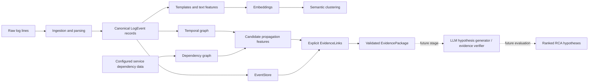
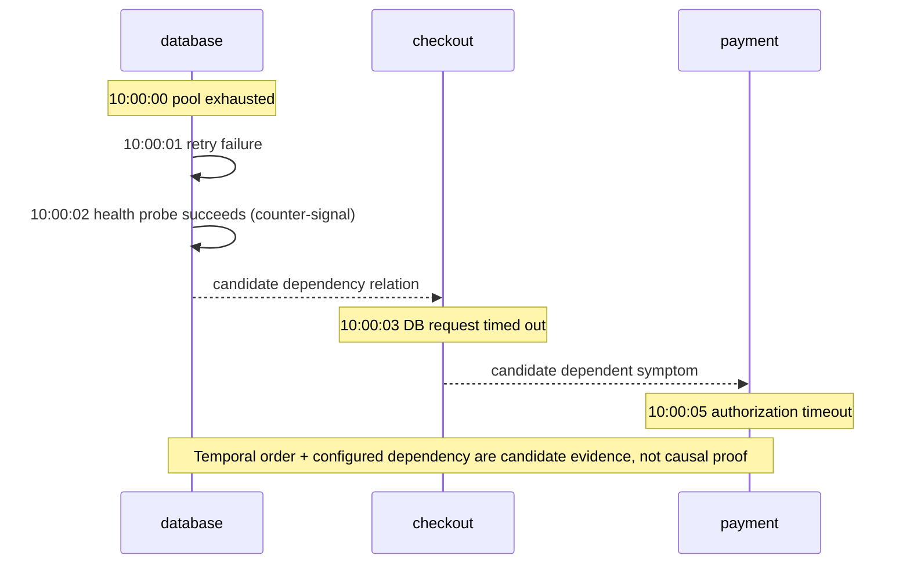

# Review 1 Architecture and Evidence Visualization

## Pipeline boundary

**Implemented in supplied code:** raw log ingestion/normalization, `LogEvent`, template extraction, TF-IDF/SVD or sentence-transformer embedding backends, semantic clustering, artifact/manifest writing, evidence schemas/store/builder/graph adapter, and Member 2 temporal/dependency modules (provided separately and included in this handoff copy).

**Not implemented as a complete evaluated loop:** production LLM hypothesis generation, verified claim extraction, end-to-end RCA ranking over a labelled dataset, and comparative experiments for the three LLM baselines.

## Synthetic incident timeline (demonstration only)

This is a controlled synthetic demonstration. `database -> checkout -> payment` in the diagram is a conceptual flow, not an experimentally discovered graph. The graph implementation's service dependency direction is **consumer -> provider**; propagation analysis traverses the opposite direction to identify potential downstream symptoms.

## Recommended evidence table for Review 1

| Evidence row | Required fields | Review assertion |
|---|---|---|
| Candidate | Candidate event ID and concise event snapshot | Candidate is an event in the canonical EventStore |
| Supporting relationship | Source ID, target ID, relationship type, polarity, score, provenance | Both endpoint IDs exist; label remains “supporting signal,” not proof |
| Contradicting relationship | Same fields as supporting link, with `polarity=contradicting` | Counterevidence remains visible and is not overwritten |
| Package summary | Candidate IDs, support/contradiction summaries, derived score fields | Schema/invariants agree with underlying evidence items |
| Evaluation | Denominator, invalid-reference count, duplicate rate, runtime | Metrics can be independently recomputed from artifacts |

## Artifact map

A standard log-intelligence run writes `events.jsonl`, `parse_failures.jsonl`, `templates.json`, `template_embeddings.npy`, `clusters.json`, `event_clusters.jsonl`, `run_manifest.json`, and `evaluation.json` only when labels were supplied. The experiment wrapper adds `experiment_manifest.json` with dataset provenance, environment, runtime, configuration, measured availability, and artifact hashes.
